  

  
  
  
  
  

  

---

### Overview

> *"A 0.5mm miss turns a 10.9 into an 8. I treat retrieval the same way: measure it, then tune it."*

- **Engineering:** Machine Learning Engineer focusing on NLP, dense retrieval (FAISS, Cross-Encoders), speech processing (Whisper), and clinical data systems (FHIR R4, ABDM).
- **Academics:** B.Tech in Computer Science (Data Science) @ Manav Rachna International Institute of Research and Studies (CGPA: **8.95**, 2023–2027).
- **Athletics:** National gold medalist in 10m Air Rifle (6th Khelo India Youth Games) with 7 national championship medals.

---

### Experience

#### NLP Intern · Miimansa AI Systems `(Jun 2026 — Present)`
- **ABDM Consent Lifecycle:** Built the webhook consumer and Redis pub/sub queue for NHA HIP/HIU milestone events (M1–M3 sandbox exit); implemented consent request workers, ephemeral ECDH key exchange, and scheduled crypto-shredding sweepers for post-expiry artifact purges.
- **Inpatient OCR Parser:** Built a `pdfplumber` + `PyMuPDF` extraction pipeline for 455+ hospital billing layouts; wrote custom font de-duplication heuristics (`de_quadruple()` / `de_double()`) and schema classifiers mapping variable invoice layouts to unified NHCX schemas.
- **FHIR R4 Attribution:** Handled FHIR bundle attribution, clinical document serialization, and care-context linking for live ABHA accounts during national sandbox testing.

#### Data Science Intern · ShadowFox `(Jun 2025 — Jul 2025)`
- **AQI Regression:** Built a time-series forecasting pipeline over 2,081 daily records using lag features and rolling averages; achieved **$R^2 = 0.87$** and **MAE = 22.14** with XGBoost (tuned via 5-fold TimeSeriesSplit).
- **Classification:** Categorized Delhi air quality into 6 AQI severity bands (**83% test accuracy**), identifying that 96% of historical readings exceeded PM2.5 hazard thresholds.

#### Data Analytics Intern · IBM SkillsBuild / CSRBOX `(Jun 2024 — Aug 2024)`
- Built Power BI dashboards analyzing 100,000+ UK road accident records to identify high-density spatial risk zones.

---

### Selected Systems

| System | Architecture & Implementation | Measured Benchmarks | Stack | Links |
|:---|:---|:---|:---|:---:|
| **[AdaptLearn AI](https://github.com/ash-myth/adaptive-learning-ai)** | Multi-stage course recommendation engine indexing 13,618 courses across 6 platforms. SBERT + BM25 dual candidate retrieval, continuous 5-step α-ramp NMF collaborative filtering, and topological prerequisite DAG gating. | **64.6% CV Acc** (5-class difficulty) **71.8% Acc** (Dropout risk) **0.5761** CF RMSE **13,618** Courses indexed | `FastAPI` `SBERT` `NMF` `HistGBM` `PyTorch` | [Repo](https://github.com/ash-myth/adaptive-learning-ai) |
| **[Hindi ML Assistant](https://github.com/ash-myth/ml-course-assistant)** | Cross-lingual spoken RAG over 38 Hindi ML lectures (17,619 timestamped Whisper chunks). Two-stage FAISS (384D) + Cross-Encoder reranking with ±30s chunk expansion. | **80% Hit@3** (50-query test suite) **p95 839ms** latency **17,619** Chunks transcribed CI gate on Hit@3 ≥ 0.75 | `FastAPI` `FAISS` `Whisper` `LangSmith` `Docker` | [Repo](https://github.com/ash-myth/ml-course-assistant) · [Live](https://ash-myth.github.io/ml-course-assistant) |
| **[AutoEDA Pro](https://github.com/ash-myth/autoeda-pro)** | Automated EDA & AutoML pipeline benchmarking 6 Scikit-learn models with auto task routing. Passes pre-computed Pearson & Spearman correlation suspect pairs as grounded context to a Groq Llama 3.3-70B analyst layer. | **73.7% Acc** on Titanic baseline **0–100** Quality score ReportLab PDF export | `Streamlit` `Scikit-learn` `Groq API` `ReportLab` | [Repo](https://github.com/ash-myth/autoeda-pro) · [Live](https://autoeda-pro-ashmitchatterjee.streamlit.app/) |
| **[SCATT Analyser](https://github.com/ash-myth/scatt_analyser)** | Session intelligence tool for 10m rifle athletes. Reverse-engineered proprietary zlib-compressed `.scatt-expert` SQLite binary blobs; extracted scorecards and hold stability metrics with OpenCV and Tesseract OCR. | **35+ Sessions** parsed Shot archetype clustering Fatigue-delta tracking | `OpenCV` `Tesseract` `Streamlit` `SQLite` | [Repo](https://github.com/ash-myth/scatt_analyser) · [Live](https://scattanalyser-ashmit.streamlit.app/) |
| **[AI Resume Matcher](https://github.com/ash-myth/AI_Resume_Ranker)** | Semantic candidate-to-job matching pipeline using BERT embeddings and rule-based NER to extract technical skills and compute cosine similarity against job descriptions. | **100+** Skills extracted Evaluated on 50+ test resumes Real-time Streamlit scoring | `BERT` `Sentence-Transformers` `Streamlit` `NLP` | [Repo](https://github.com/ash-myth/AI_Resume_Ranker) · [Live](https://resume-ranker-ashmitchatterjee.streamlit.app/) |
| **[Air Quality Prediction](https://github.com/ash-myth/AQI_Analysis)** | Time-series forecasting pipeline over 2,081 daily AQI records with lag features, rolling windows, and 5-fold TimeSeriesSplit benchmarking. | **$R^2 = 0.87$** **MAE = 22.14** (XGBoost) **83%** 6-class AQI Acc | `XGBoost` `Scikit-learn` `Pandas` `Seaborn` | [Repo](https://github.com/ash-myth/AQI_Analysis/blob/main/AQI_Prediction.ipynb) |

---

### Technical Stack

  

- **Languages & Core:** Python, C++, SQL, Bash, Git, Linux
- **ML, NLP & Retrieval:** PyTorch, Scikit-learn, Sentence-Transformers, FAISS, Cross-Encoders, Hugging Face, Whisper
- **Backend & Cloud:** FastAPI, Docker, Redis (Pub/Sub), Microsoft Azure (DP-100), PostgreSQL, Streamlit

---

### Research & Certifications

- **IEEE Publication:** *"Bridging Drug Discovery and Public Health: AI-Driven Web Platform with Symptom-Aware Chatbot"* — **ICAICCIT 2025** ([IEEE Xplore #11434437](https://ieeexplore.ieee.org/document/11434437)).
- **Microsoft Certified:** Azure Data Scientist Associate (**DP-100**)
- **Microsoft Certified:** Azure AI Fundamentals (**AI-900**)
- **Oracle Certified:** Oracle AI Vector Search Certified Professional
- **Oracle Certified:** OCI 2024 Certified AI Foundations Associate
- **DataCamp Certified:** AI Engineer for Data Scientists Associate
- **GDG Cloud Kochi:** Code Vipassana S14 Top 100 & S15 Exceptional (Serverless Data Agents & Agentic Cloud)

---

### Athletics: 10m Air Rifle

Dual-career athlete competing at national and international levels in Olympic 10m Air Rifle:

| Competition | Stage / Event | Year | Result |
|:---|:---|:---:|:---|
| **6th Khelo India Youth Games** | Chennai, Tamil Nadu | 2024 | 🥇 **Gold Medal (First Place)** |
| **FISU World University Trials** | India Selection Trials | 2024 | 🏅 **4th Rank Nationally** |
| **National Shooting Championships** | National Governing Body | 2023–2025 | 🥇 **3 Gold**, 🥉 **4 Bronze Medals** |
| **SportsForAll Sponsorship Program** | New Delhi | 2024 | 🥇 **Winner (Champion of Champions ISSF Men)** · 🥇 1st Junior · 🥉 3rd Senior |
| **Indonesian Open Championship** | International Championship | 2020 | 🥉 **Bronze Medal** |
| **All India University Games** | Haryana | 2024 | 🥉 **Bronze Medal (Team)** · 5th Individual |
| **All India KSS Memorial Championships** | Bhopal, MP | 2024 & 2026 | 🥇 **2 Gold**, 🥈 **3 Silver Medals** |
| **54th West Bengal State Championship** | Asansol, WB | 2022 | 🏆 **Highest Medal Winner (11 Medals)** |

---

### Activity & Stats

  
  

  

